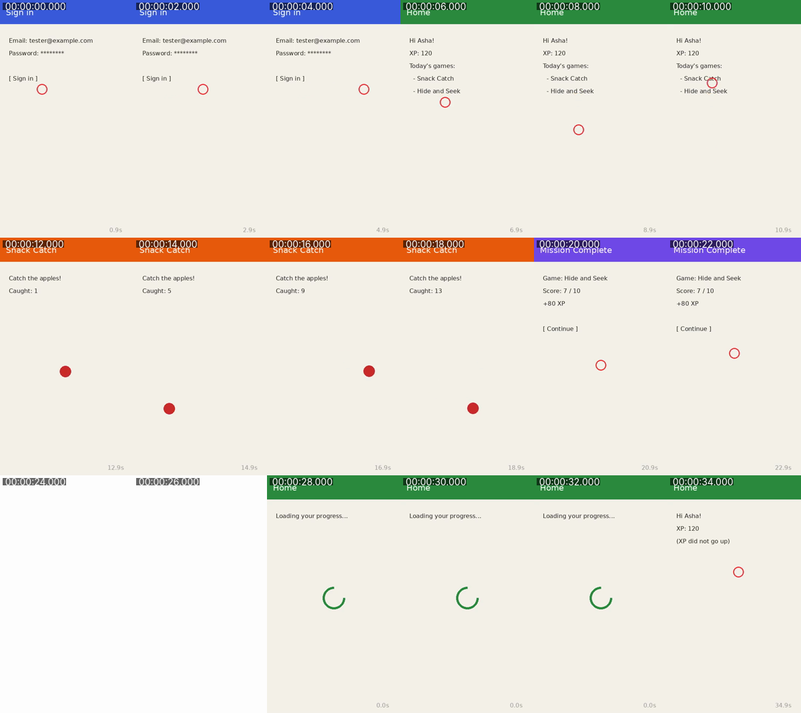
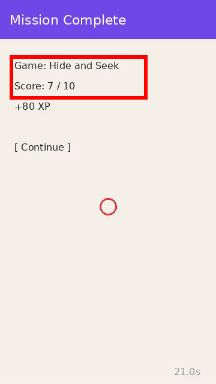

# vid2bug

Turn a screen recording of a test session into a bug report developers can act on.

I test mobile-first web apps by recording my screen while I play through them. Writing the bugs up afterwards was the slow part: scrubbing back through a 15-minute video for the right second, taking screenshots, and copying everything into the team's bug sheet. vid2bug does the mechanical part. On a real app it turned a 17-minute Android recording into a 29-bug report with evidence frames in one sitting.

## What it does

| Step | Command | Output |
|---|---|---|
| See the whole session at a glance | `scan` | Contact sheets: thumbnail grids with the timestamp burned into every tile |
| Find problems nobody narrated | `scan` | Black screens, white/blank screens and frozen screens, with start and end times |
| Draft bugs with AI (optional) | `draft` | `bugs.draft.json`, every bug marked `needs_review` |
| Produce the report | `report` | `report.md`, `bugs.csv` (paste into Jira or a Google Sheet) and full-resolution evidence frames, with a red box on the problem if you give one |

Example run on the demo recording in this repo:

```
$ python vid2bug.py scan examples/demo.mp4 -o examples/demo-output --every 2 --cols 6 --rows 3
1 contact sheet(s) in examples/demo-output/sheets (one frame every 2.0s)
  00:24-00:27  white/blank screen for 3.0s
  00:27-00:33  frozen screen for 6.0s
```



Full output: [examples/demo-output/report.md](examples/demo-output/report.md) and [bugs.csv](examples/demo-output/bugs.csv).



## Quick start

Needs Python 3.9+ and [ffmpeg](https://ffmpeg.org/download.html) on your PATH. Nothing to pip install.

```bash
git clone https://github.com/S-YED/vid2bug && cd vid2bug

# 1. Contact sheets + automatic signals
python vid2bug.py scan session.mp4 -o out

# 2a. Write out/bugs.json yourself (format: examples/bugs.example.json) ...
# 2b. ... or let Claude draft it from the sheets, signals and your notes
export ANTHROPIC_API_KEY=...            # Windows: set ANTHROPIC_API_KEY=...
python vid2bug.py draft -o out --notes notes.txt

# 3. Review the draft against the video, then build the report
python vid2bug.py report session.mp4 out/bugs.json -o out --title "Build 2.4 smoke test"

# Grab any frame you need
python vid2bug.py frames session.mp4 -t 01:23 -t 02:05
```

## How the AI step works, and why you still review it

`draft` sends the contact sheets, the tile-to-timestamp index, the detected signals and your own notes to Claude, and asks for a JSON list of bugs with steps, expected vs. actual, severity, evidence timestamps and a confidence level. The prompt tells the model to report only what is visible in the frames or written in the notes.

AI drafts still get things wrong: a frozen stretch might just be the tester reading, or a timestamp can be off by a tile. So every drafted bug comes back with `"needs_review": true`, and `report` labels it **DRAFT** until you have checked it against the recording and set the flag to `false`. The tool saves the typing; the judgement stays with the tester.

## bugs.json format

```json
{
  "id": "BUG-01",
  "title": "Mission Complete shows the previous game's name and score",
  "severity": "Critical",
  "area": "Results / scoring",
  "times": ["00:21"],
  "box": [16, 92, 230, 74],
  "steps": ["Sign in", "Open Snack Catch", "Play until the round ends"],
  "expected": "Mission Complete shows Snack Catch and 13 apples",
  "actual": "Shows 'Hide and Seek' with 'Score: 7 / 10'",
  "fix_hint": "Results screen may read a stale report from the last game"
}
```

`severity` is Critical, High, Medium or Low. `times` takes `ss`, `mm:ss` or `hh:mm:ss`. `box` is optional: `[x, y, width, height]` in pixels of the original video.

## Tuning

| Option | Default | When to change |
|---|---|---|
| `--every` | 3 s | Lower it to catch fast flicker, raise it for long sessions |
| `--min-blank` | 1.5 s | Shortest black or white stretch to report |
| `--min-frozen` | 4 s | Shortest stretch with no change to report |
| `--freeze-noise` | 0.0003 | Raise it if a noisy or heavily compressed recording hides real freezes |
| `--no-signals` | off | Skip detection for a faster scan |

## Tests

```bash
python -m unittest discover tests -v
```

The end-to-end tests build a synthetic video with planted black, white and frozen stretches and check that `scan` finds exactly those, and that `report` sorts by severity and writes the evidence frames.

To rebuild the demo recording: `pip install pillow && python examples/make_demo_video.py examples/demo.mp4`.

## Limits

- Detection looks at whole-screen changes. A spinner that keeps spinning while nothing loads is not "frozen"; you still need your eyes and notes for that.
- Timestamps in contact sheets come from ffmpeg's `drawtext`. If your ffmpeg build has no default font, the tool falls back to Arial on Windows, then to unlabelled tiles plus the `sheets` index in `scan.json`.

## License

MIT
