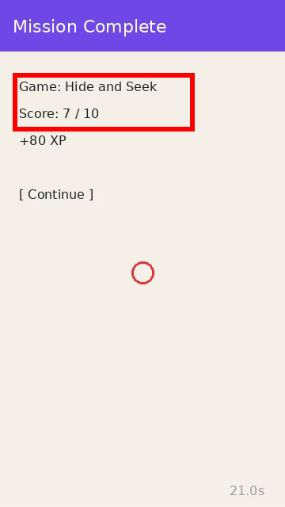
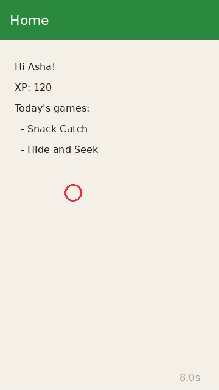
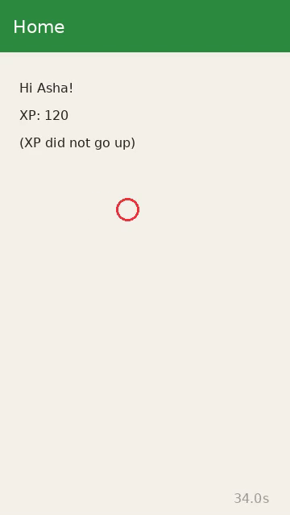
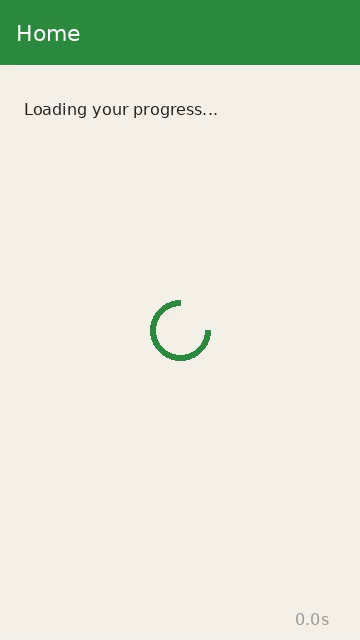

# Demo: learning-game app test session

4 bugs · 1 Critical · 2 High · 1 Medium

| ID | Severity | Title | Time |
|---|---|---|---|
| [BUG-01](#bug-01) | Critical | Mission Complete shows the previous game's name and score | 00:21 |
| [BUG-02](#bug-02) | High | Blank white screen for 3 seconds after tapping Continue | 00:25 |
| [BUG-04](#bug-04) | High | XP does not increase after finishing a game | 00:08, 00:34 |
| [BUG-03](#bug-03) | Medium | Home stuck on 'Loading your progress...' for 6 seconds | 00:28, 00:32 |

## BUG-01

**Mission Complete shows the previous game's name and score**

- **Severity:** Critical
- **Area:** Results / scoring
- **Seen at:** 00:21

**Steps to reproduce**

1. Sign in
2. Open Snack Catch from Home
3. Play until the round ends

**Expected:** Mission Complete shows Snack Catch and the apples caught (13)

**Actual:** Mission Complete shows 'Hide and Seek' with 'Score: 7 / 10'

**Fix hint:** Results screen may read a stale report from the last game; check that the report is fetched by the current game session id

## BUG-02

**Blank white screen for 3 seconds after tapping Continue**

- **Severity:** High
- **Area:** Results -> Home navigation
- **Seen at:** 00:25

**Steps to reproduce**

1. Finish any game
2. Tap Continue on Mission Complete

**Expected:** Home opens straight away, or a loading state is shown

**Actual:** The whole screen is white for about 3 seconds

## BUG-04

**XP does not increase after finishing a game**

- **Severity:** High
- **Area:** Home / XP
- **Seen at:** 00:08, 00:34

**Steps to reproduce**

1. Note XP on Home (120)
2. Play Snack Catch to the end
3. Return to Home

**Expected:** XP = 120 + 80 = 200, as promised on Mission Complete

**Actual:** XP is still 120

**Fix hint:** Verify the XP update is saved to the database, not only shown on the results screen

## BUG-03

**Home stuck on 'Loading your progress...' for 6 seconds**

- **Severity:** Medium
- **Area:** Home
- **Seen at:** 00:28, 00:32

**Steps to reproduce**

1. Finish any game
2. Tap Continue
3. Wait on Home

**Expected:** Progress loads in under 2 seconds

**Actual:** Spinner shows for about 6 seconds with no change

**Fix hint:** Check the progress API response time and add a timeout with retry

## Automatic signals

Stretches where the screen was black, blank or did not change. Not every one is a bug (the tester may have been reading), but long ones are worth a look.

| Time | Signal | Seconds |
|---|---|---|
| 00:24-00:27 | white/blank screen | 3.0 |
| 00:27-00:33 | frozen screen | 6.0 |
